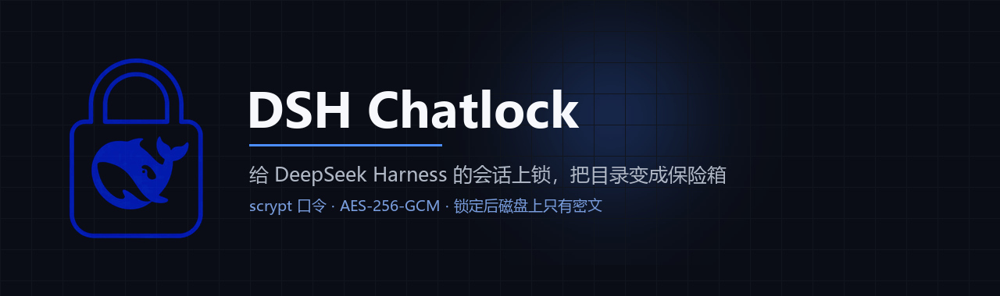

<p align="center">
  
</p>

<p align="center">
  <a href="#三十秒装完"></a>
  
  
  
  
</p>

<p align="center">
  <a href="#两件事"><b>它做什么</b></a> ·
  <a href="#三十秒装完"><b>安装</b></a> ·
  <a href="#它能挡住谁"><b>威胁模型</b></a> ·
  <a href="#三个把我打回来的坑"><b>踩坑</b></a> ·
  <a href="#自检"><b>自检</b></a>
</p>

---

## 两件事

| 会话锁 | 保险箱 |
| --- | --- |
| 在侧栏给某个会话上锁，再打开时会话区模糊、弹密码框，口令错了就是错了。 | 把一个目录整体做成 AES-256-GCM 密文，锁定后磁盘上只剩 `.bin`，连原始文件名都读不出来。 |

两个能力共用一把口令。口令只存 scrypt 派生值，明文不落盘；「已解锁」这个状态只活在内存里，进程一重启就全没了，这也是最可靠的一把自动锁。

> 会话记录本身没有做磁盘加密，因为 DSH 启动要读它才能出会话列表。所以第一件事是**界面锁**，第二件才是**磁盘锁**。这个区别很重要，后面「威胁模型」那节会摊开讲。

## 三十秒装完

```bash
git clone https://github.com/xevil3301/dsh-chatlock
cd dsh-chatlock
node install.mjs                 # 默认装进 desktop profile
node install.mjs --profile web   # 或者别的 profile
```

装完**必须重启 dsh**。宿主那半边不热重载，改文件等十秒日志里一行新东西都没有。

然后打开设置，「聊天锁」那一页，先设密码。回到侧栏，鼠标移到任意会话上会冒出一个锁，点它。

## 它能挡住谁

「别人打开本地文件夹必须经过 DSH」这句话，在应用层不成立。Windows 不会问一个进程「你经过 DSH 了吗」，Explorer、cmd、任何程序读文件走的都是文件系统。想真正实现「打开目录先弹密码」，只有挂一个文件系统驱动（WinFsp / Dokan），真实数据永远密文，解锁后由驱动透明解密。

那是另一个量级的工程。这一版给你的是下面三层里的第二层。

| 层 | 做到什么 | 挡得住谁 | 代价 |
| :-- | :-- | :-- | :-- |
| ① 界面锁 | 不输密码看不见会话内容 | 走到你电脑前、能操作 DSH 的人 | DOM 里仍有文字 |
| ② 磁盘锁 | 目录里只有密文，文件名也加密 | 打开或拷走目录的人、拿走硬盘的人 | 解锁期间磁盘上是明文 |
| ③ 虚拟盘 | 数据永远密文，驱动透明解密 | 除了解锁中的机器以外全部 | 要装驱动 + 自建 FS 后端，未做 |

还有一条正交的线，对方用的是哪个 Windows 账户。

**另一个账户**登录这台机器的话，NTFS ACL 就够了，`icacls` 一条命令，甚至不需要密码。加密真正派上用场是在文件被拷走、换机器、硬盘被拿走的时候。

**同一个账户**的话，ACL 一点用都没有。这种情况只有第三层才成立，第二层能做的是把明文的时间窗口压到最短。所以有了这三个开关。

- 解锁后密钥只留在内存，空闲十五分钟（可调）自动锁回去，不用再输密码
- 「立即锁全部保险箱」，同样用内存里的密钥
- 进程退出等于所有密钥蒸发

> 进程被强杀是没有清理钩子的。所以别把正在写入的工作区当保险箱，它是归档区。

## 三个把我打回来的坑

<details open>
<summary><b>一 · 白底白字</b></summary>

密码框的主按钮一度是空白的，只有一个白框，什么字都没有。

查下来是配色。我用 `--dsw-alias-brand-primary` 当背景，又自己写死了 `color: #fff`。而这个变量在暗色主题里是 `#f9fafb`，近白。白底白字，按钮没有消失，它只是看不见。

正确的写法是用主题里本来就成对的那一组。

```css
background: var(--dsw-alias-button-primary-fill);
color:      var(--dsw-alias-label-primary-foreground);
```

</details>

<details>
<summary><b>二 · 一个根本不存在的变量</b></summary>

`--dsw-alias-bg-layer-4` 我拿来当输入框底色用了很久，样式没崩，因为 `var()` 有 fallback，不报错，静默吃默认值。

直到把主题里四百多个变量全拉出来对了一遍，才发现这个 token 一次都没定义过。现在整份 CSS 用的十四个变量，每一个都能在主题里找到定义，两套主题的值都核过。

</details>

<details>
<summary><b>三 · 加密了目录，却把文件名摊在磁盘上</b></summary>

保险箱加密了所有文件，但它的清单 `manifest.json` 里写着原始相对路径。别人打开目录，内容读不出来，却能一眼看到 `客户资料/2026Q3/报价单.md`。

加密了，等于没加密。现在清单也用同一把钥匙、同一套容器格式加密。

顺手修了一个更隐蔽的问题。拿错误的口令去锁一个已经锁着的保险箱，旧代码会把清单当成「没锁过」重新扫，然后用错的钥匙覆盖掉真正的文件清单，那个目录就永久救不回来了。现在这种情况直接拒绝，不动一个字节。

</details>

## 自检

| 命令 | 它证明什么 |
| :-- | :-- |
| `node scripts/audit.mjs` | 没有僵尸导出，没有多余的 import |
| `node test/smoke.mjs` | 口令哈希、授权过期、保险箱加解密往返 |
| `node test/host-fake.mjs` | 假 ctx 跑 host 半边，路由、`ctx.fs` 守卫、保险箱全流程 |
| `node test/client-wire.mjs` | 假 window 跑 client 半边，自注册与四个槽位 |
| `node test/live-check.mjs` | 真机验证，打运行中的实例 |

最后那个会按 DSH 自己的算法签一个浏览器会话 cookie，等价于一个已登录的标签页。原因很简单，DSH 的 `/api` 栅栏不是「回环就放行」，回环只是第一道，真正放行的是签名 cookie。命令行拿不到它，curl 一律 401，很容易误判成插件没装上。

```bash
node test/live-check.mjs --port <你的端口>
node test/live-check.mjs --mutate     # 写入往返，跑完自己清干净
```

## 这堆文件是什么

```
index.js              host 半边，状态、口令、授权表、路由、ctx.fs 守卫
client.js             浏览器半边，遮罩弹窗、侧栏锁标、上锁按钮、设置页
lib/state.mjs         状态读写与归一化，原子写，坏文件自愈
lib/secret.mjs        口令哈希、保险箱密钥派生、内存授权表
lib/crypt.mjs         文件级 AES-256-GCM，流式，tag 放尾部
lib/vault.mjs         保险箱，可中断的加密解密、加密清单、路径越界防护
lib/routes.mjs        /api/chatlock/* 处理器与信任栅栏
demo/vault-demo.mjs   加密前后的目录对比，跑一次就懂
scripts/audit.mjs     死代码审计
scripts/make-assets.py  banner 与图标的生成脚本
test/                 四个套件
docs/marketplace.md   怎么上架 DSH 市场
```

## 边界

- **聊天锁是界面锁**，不是磁盘加密。要磁盘级保护，把导出的会话或私密资料目录登记成保险箱
- **保险箱是整目录上锁和解锁**，不是实时透明加密。边用边透明需要的还是那个文件系统驱动
- 符号链接不跟随；单文件超过 512MB 会跳过并在结果里点名，不会静默漏掉
- 保险箱路径不允许互相嵌套，内外两把盐各管一半，加密状态会打架
- 保险箱忘记密码，数据不可恢复。scrypt 派生，没有后门，没有找回

## 最后

这东西一开始只是「加个密码」，最后变成一次把「我以为什么是安全的」全部推翻重来的过程。上面的表格、三个坑、四套自检，都是被真问题打出来的，不是设计出来的。

我自己的判断是，它能挡住大部分日常场景，室友、同事、来你家玩的朋友、以及那些不小心走错屋子的目光。挡不住的是有心人拿走了硬盘，或者你解锁的机器就摆在别人桌上。

想清楚这一点再用它，比多加密一层更有用。

<p align="center">
  <sub>用 DSH 写的，也用 DSH 验的 · MIT · <a href="https://github.com/xevil3301/dsh-chatlock/issues">提 issue</a></sub>
</p>
